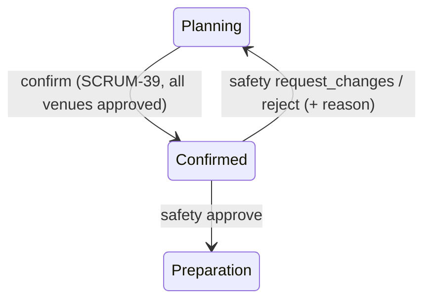
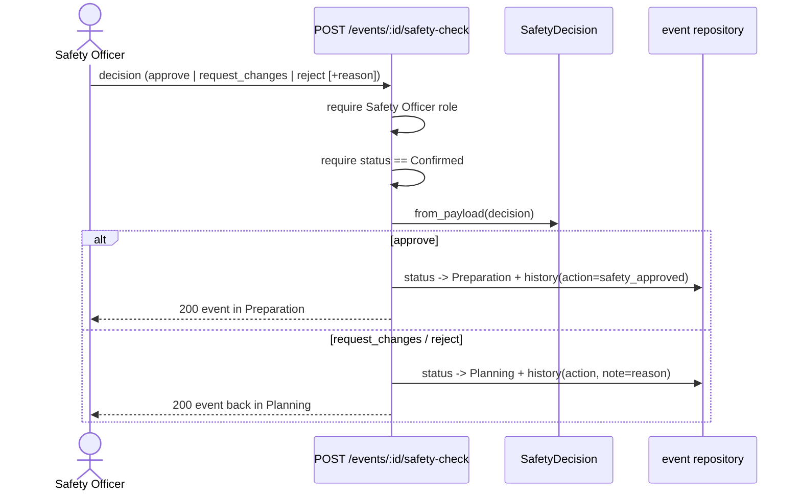

# SCRUM-128: Operational Safety Check before preparation

> Status: **in progress** — increments 1 (pure decision + unit tests) and 2
> (`POST /events/<id>/safety-check` endpoint + `Preparation` status + integration tests)
> are complete. Increment 3 (Safety Officer review UI + E2E) is blocked on an access
> decision — see "Open: Safety Officer view access" below. Builds on SCRUM-39
> (branch `feature/SCRUM-128-safety-check`).

As a Safety Officer, I want to review a confirmed event's operational safety and
approve / reject / request changes, so unsafe events do not proceed to preparation
(Week 7 customer change #6). The event lifecycle gains a stage:
**Confirmed → (safety review) → Preparation**.

## The state machine (PO decisions)

The safety review acts on a **Confirmed** event — there is no separate "Operational
Safety Check" status; a Confirmed event is the safety-review queue. The Safety Officer's
decision moves the event:

| Decision | New status | Meaning |
|----------|------------|---------|
| approve | **Preparation** (new status) | the event may proceed to preparation |
| request_changes | Planning | return to re-review the affected venue/technical arrangements |
| reject | Planning | safety-rejected; the team reworks and resubmits |

An event **cannot reach Preparation except through an approval** — approval is the only
transition that produces `Preparation`, so the preparation gate is enforced by construction.

## Why a separate value object

Like `EventDecision` / `BookingDecision`, the decision rule is pure logic — valid action,
the status it produces, and the reason required when the event is sent back. It has no
persistence, so it is unit-testable in isolation; the endpoint and repository handle the
status change and the audit. The implementation lives in `api/app/safety_decision.py`.

- `SafetyDecision(action, reason=None)` — `action` is `approve` / `request_changes` /
  `reject`. A **non-blank reason is required** for `request_changes` and `reject` (the team
  needs to know what to address); it is dropped on `approve`.
- `SafetyDecision.from_payload(data)` — build from client JSON (`decision`, optional
  `reason`), rejecting unknown keys.
- `.status` → the event status the decision produces.
- `.approved` → `True` only for `approve`.
- `.returns_to_planning` → `True` when the decision sends the event back.

## Test coverage

`api/tests/test_safety_decision.py` (24 unit cases, parametrised). Each traces to an AC and
would fail for a plausible wrong implementation:

- approve → `Preparation`, `approved`, reason dropped;
- request_changes / reject → `Planning`, reason trimmed, not approved;
- reject/request_changes with a missing, blank, or non-text reason → `ValueError`;
- unknown or wrongly-cased action → `ValueError`;
- `from_payload` builds approve/reject, and rejects unknown keys / non-dict input.

## The endpoint (increment 2)

`POST /events/<event_id>/safety-check` (`api/app/events.py`). In order:

1. requires the configured frontend origin;
2. requires an acting user who is a **Safety Officer** (`require_role`) — authorisation is
   by role, not organiser/coordinator relatedness (the Safety Officer role is SCRUM-127);
3. loads the event; `404` if missing;
4. requires the event is **Confirmed** — otherwise `409` (the check follows SCRUM-39);
5. parses the decision (`SafetyDecision.from_payload`); a bad/blank payload is `400`;
6. moves the event to the decision's status (`Preparation` / `Planning`) and writes a
   status-history entry carrying the actor, timestamp, a safety **action**
   (`safety_approved` / `safety_changes_requested` / `safety_rejected`) and the **reason**
   as the note — the audit required by the ACs.

A new **`Preparation`** status is added to `EventStatus._mapping` (`event_status.py`).
`PATCH /events/<id>/status` is also **locked out of `Preparation`** (as it is for
`Confirmed`, SCRUM-39), so the only route into preparation is a safety approval.

### Lifecycle & flow (Week 5 diagrams)

## Endpoint test coverage

`api/tests/test_safety_check_route.py` (7 integration tests): approve → `Preparation`;
the approval is audited with actor + `safety_approved` action; request_changes and reject
→ `Planning` with the reason recorded; a send-back without a reason → `400`; a
non-Safety-Officer → `403`; a non-Confirmed event → `409`. Plus a `Preparation`-lock test
in `test_event_status.py`. The Safety Officer demo user (id 6) is appended per-test rather
than editing the shared conftest. Full suite: **584 passed, 36 skipped, ruff clean.**

> The audit tests read `/history` as the related Coordinator, because — see below — a
> Safety Officer is not currently a related viewer of the event.

## Open: Safety Officer view access (blocks the UI)

`require_event_access` (and `GET /events/<id>`, `/history`) require the caller to be
*related* to the event (organiser / coordinator / participant). A Safety Officer is
none of these, so they can act on the safety check but **cannot currently load the event
to review it** — which the review UI (increment 3) needs. Resolving this is a shared
access-control decision (e.g. grant Safety Officers role-based read access to Confirmed
events, or add them as event participants when a review is needed). Pending Marcus's call.

## Dependency

The **Safety Officer role (SCRUM-127, Jerome)** is not yet in the seed/`app_users`. The
endpoint requires that role; tests inject a demo Safety Officer. Real use needs SCRUM-127
merged so the role exists and can be assigned.
