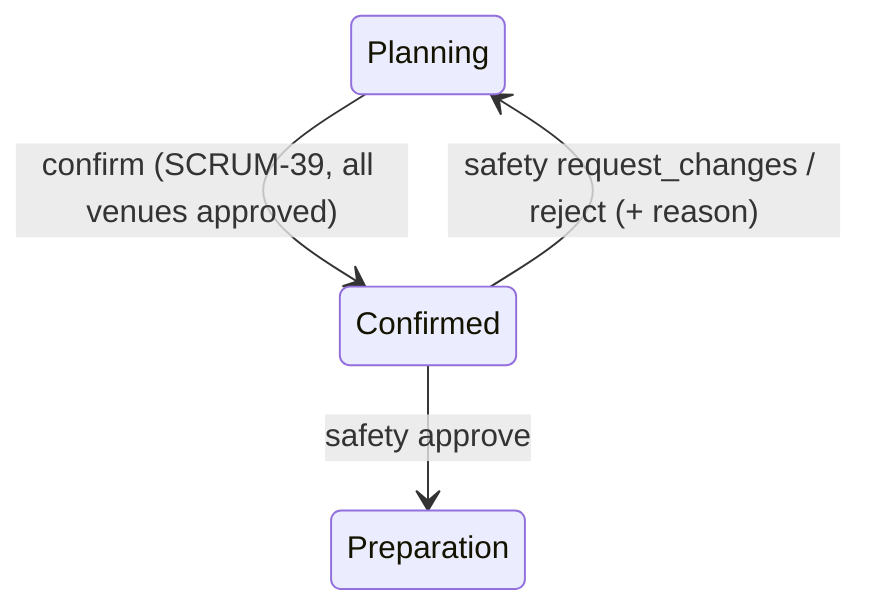
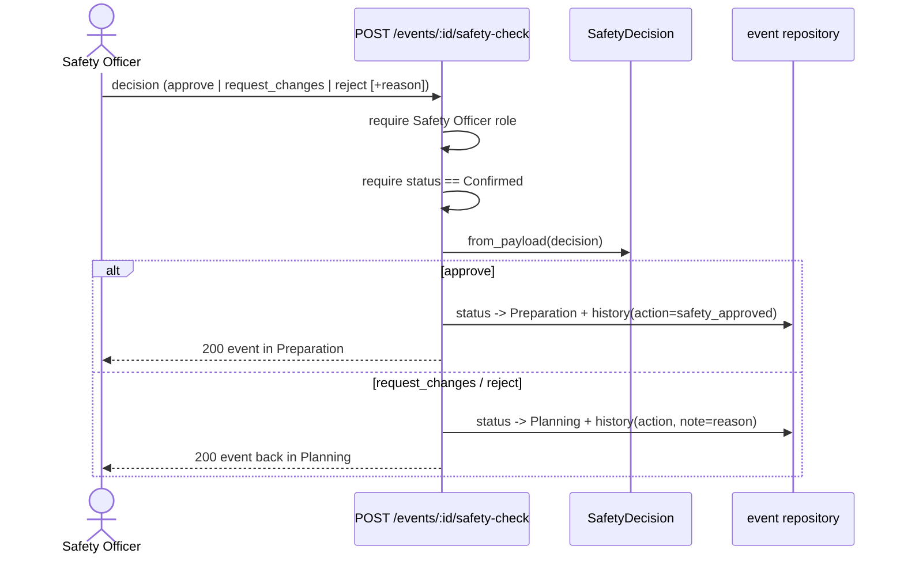

# SCRUM-128: Operational Safety Check before preparation

> Status: **code complete** — increment 1 (pure decision + unit tests), increment 2
> (`POST /events/<id>/safety-check` + `Preparation` status + integration tests), and
> increment 3 (Safety Officer read access + review UI + E2E) are done. Remaining before
> Done: SCRUM-127 (the Safety Officer role in the seed), your review, PR + green CI, and
> Jira test-case evidence. Builds on SCRUM-39 (branch `feature/SCRUM-128-safety-check`).

As a Safety Officer, I want to review a confirmed event's operational safety and
approve / reject / request changes, so unsafe events do not proceed to preparation
(Week 7 customer change #6). The event lifecycle gains a stage:
**Confirmed → (safety review) → Preparation**.

## The state machine (PO decisions)

The safety review acts on a **Confirmed** event — there is no separate "Operational
Safety Check" status; a Confirmed event is the safety-review queue. The Safety Officer's
decision moves the event:

| Decision | New status | Meaning |
|----------|------------|---------|
| approve | **Preparation** (new status) | the event may proceed to preparation |
| request_changes | Planning | return to re-review the affected venue/technical arrangements |
| reject | Planning | safety-rejected; the team reworks and resubmits |

An event **cannot reach Preparation except through an approval** — approval is the only
transition that produces `Preparation`, so the preparation gate is enforced by construction.

## Why a separate value object

Like `EventDecision` / `BookingDecision`, the decision rule is pure logic — valid action,
the status it produces, and the reason required when the event is sent back. It has no
persistence, so it is unit-testable in isolation; the endpoint and repository handle the
status change and the audit. The implementation lives in `api/app/safety_decision.py`.

- `SafetyDecision(action, reason=None)` — `action` is `approve` / `request_changes` /
  `reject`. A **non-blank reason is required** for `request_changes` and `reject` (the team
  needs to know what to address); it is dropped on `approve`.
- `SafetyDecision.from_payload(data)` — build from client JSON (`decision`, optional
  `reason`), rejecting unknown keys.
- `.status` → the event status the decision produces.
- `.approved` → `True` only for `approve`.
- `.returns_to_planning` → `True` when the decision sends the event back.

## Test coverage

`api/tests/test_safety_decision.py` (24 unit cases, parametrised). Each traces to an AC and
would fail for a plausible wrong implementation:

- approve → `Preparation`, `approved`, reason dropped;
- request_changes / reject → `Planning`, reason trimmed, not approved;
- reject/request_changes with a missing, blank, or non-text reason → `ValueError`;
- unknown or wrongly-cased action → `ValueError`;
- `from_payload` builds approve/reject, and rejects unknown keys / non-dict input.

## The endpoint (increment 2)

`POST /events/<event_id>/safety-check` (`api/app/events.py`). In order:

1. requires the configured frontend origin;
2. requires an acting user who is a **Safety Officer** (`require_role`) — authorisation is
   by role, not organiser/coordinator relatedness (the Safety Officer role is SCRUM-127);
3. loads the event; `404` if missing;
4. requires the event is **Confirmed** — otherwise `409` (the check follows SCRUM-39);
5. parses the decision (`SafetyDecision.from_payload`); a bad/blank payload is `400`;
6. moves the event to the decision's status (`Preparation` / `Planning`) and writes a
   status-history entry carrying the actor, timestamp, a safety **action**
   (`safety_approved` / `safety_changes_requested` / `safety_rejected`) and the **reason**
   as the note — the audit required by the ACs.

A new **`Preparation`** status is added to `EventStatus._mapping` (`event_status.py`).
`PATCH /events/<id>/status` is also **locked out of `Preparation`** (as it is for
`Confirmed`, SCRUM-39), so the only route into preparation is a safety approval.

### Lifecycle & flow (Week 5 diagrams)

## Endpoint test coverage

`api/tests/test_safety_check_route.py` (7 integration tests): approve → `Preparation`;
the approval is audited with actor + `safety_approved` action; request_changes and reject
→ `Planning` with the reason recorded; a send-back without a reason → `400`; a
non-Safety-Officer → `403`; a non-Confirmed event → `409`. Plus a `Preparation`-lock test
in `test_event_status.py`. The Safety Officer demo user (id 6) is appended per-test rather
than editing the shared conftest. Full suite: **584 passed, 36 skipped, ruff clean.**

> The audit tests read `/history` as the related Coordinator, because — see below — a
> Safety Officer is not currently a related viewer of the event.

## Safety Officer view access (resolved)

`require_event_access` required the caller to be *related* to the event, so a Safety
Officer could act on the check but not load the event to review it. **Resolved (PO
decision):** `require_event_access` now grants a Safety Officer **role-based read access
to events in `Confirmed`/`Preparation`** (the safety-review window) — see
`_SAFETY_REVIEW_STATES` in `events.py`. This is additive (no existing role is affected)
but is a shared access-control change — *flag at standup*. Covered by
`test_safety_officer_can_view_a_confirmed_event` and
`test_safety_officer_cannot_view_a_planning_event`.

## Frontend (increment 3)

`frontend/src/app/events/[eventId]/event-safety-check-form.tsx` adds the review panel for a
Safety Officer on a `Confirmed` event: it surfaces the event's recorded safety-relevant
details plus a checklist of the aspects to assess (capacity/layout, emergency access,
accessibility, equipment placement, crowd movement, venue restrictions — change #6), and
the three decisions. **Approve** proceeds to `Preparation`; **Request changes** / **Reject**
require a reason (validated client-side, `data-testid="safety-error"`) and send the event
back to Planning. Wired into `page.tsx`, gated on
`actingRole === "Safety Officer" && event.status === "Confirmed"`. A `Preparation` badge
style was added to `lib/events.ts`.

> The app-shell nav has no Safety Officer entry yet (falls back to Home only); a dedicated
> safety-review queue would be a separate story. Safety Officers reach an event by link.

### E2E coverage

`frontend/e2e/event-safety-check.spec.ts` (3 Playwright tests): a Safety Officer approves
and the badge becomes `Preparation`; requesting changes without a reason shows the
validation message and leaves the status `Confirmed`; a Coordinator never sees the action.
Lint, build, and the full E2E suite (**104 passing**) are green.

## Dependency

The **Safety Officer role (SCRUM-127, Jerome)** now has a rerunnable identity migration,
review queue and navigation. Apply the migration and follow the
[SCRUM-127 setup](SCRUM-127.md) before using the workflow. It also fixes the database
`Preparation` constraint and the event page's unrelated clarification request.
Historical mock tests use user 6; real deployments allocate a free ID instead.
