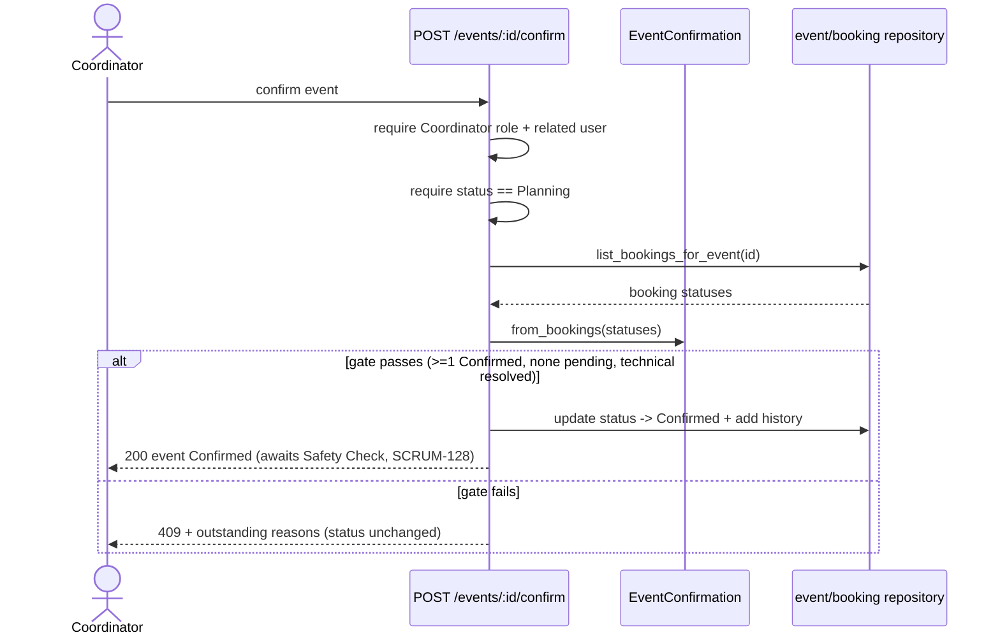

# SCRUM-39: Confirm an event (change-aware)

> Status: **code complete** — increment 1 (pure gate + unit tests), increment 2
> (`POST /events/<id>/confirm` endpoint + integration tests + status-PATCH lock), and
> increment 3 (Coordinator confirm UI + Playwright E2E) are done. Remaining before Done:
> your review, PR + green CI, and updating the Jira test-case evidence.

As a Coordinator, I want to confirm an event once its essential arrangements are
complete, so it can proceed to the Operational Safety Check (SCRUM-128). The Week 7
customer change #3 makes this a **multi-venue gate**: confirmation requires *all* of
the event's venue bookings to be approved, not just one.

## Why a separate value object

The confirmation rule is pure business logic — it depends only on the status of the
event's venue bookings, not on the database or Flask. So it follows the same pattern
the team already uses for `EventDecision` (`event_decision.py`) and `BookingDecision`
(`booking_decision.py`): a small DB-independent value object that is **unit-testable in
isolation** (fast, no Postgres), while the endpoint and repository handle persistence
and the actual state change. This is the Week 6 testing pyramid in practice — the gate
is a unit; the endpoint will be an integration test.

The implementation lives in `api/app/event_confirmation.py`.

## The gate rule

An event may be confirmed only when **all** of the following hold:

- **At least one venue booking is `Confirmed`.** A fully-resourced event must have an
  approved venue, so an event with zero bookings cannot be confirmed (PO decision).
- **No venue booking is still awaiting approval.** Anything that is not a *settled*
  `Confirmed`/`Rejected` status — `Requested`, `Pending`, or an unrecognised value —
  blocks. Unknown statuses block defensively rather than slipping through.
- **Technical arrangements are resolved.** This is the `technical_resolved` flag — the
  seam for equipment reservations (SCRUM-37). Until that story lands, the endpoint
  passes `True`; the gate logic is already complete and unit-tested both ways.

`Rejected` bookings are **settled history and do not block** (PO decision): a declined
venue request sitting in the log does not stop the event being confirmed, as long as
there is at least one approved venue and nothing still pending.

Non-essential items (programme, registration setup) are **intentionally not checked**
— AC2 requires that they must not block confirmation, so the gate never looks at them.

### API

- `EventConfirmation(booking_statuses, technical_resolved=True)` — build from a list of
  status strings.
- `EventConfirmation.from_bookings(bookings, technical_resolved=True)` — build from
  venue-booking rows (dicts with a `status` field), the shape the repository returns.
- `.can_confirm` → `bool`.
- `.outstanding` → list of human-readable blocking reasons; **empty exactly when
  `can_confirm` is `True`**. The endpoint returns these in the 409 body so the UI can
  show the Coordinator precisely what is still outstanding (AC4).

## Test coverage

`api/tests/test_event_confirmation.py` (12 unit tests). Each test traces to an
acceptance criterion and is written so a plausible wrong implementation fails it (the
Week 6 "what would have to break for this to fail?" review), not merely to accept the
current code:

- **Happy path (AC1):** all `Confirmed` → allowed; a single `Confirmed` → allowed.
- **Negative (AC4):** a `Requested` or `Pending` booking blocks; an unknown status
  blocks (defensive).
- **Boundary (PO decision):** zero bookings → blocked with "No venue…".
- **Rejected (PO decision):** `Rejected` alongside a `Confirmed` → allowed; `Rejected`
  alone (no approved venue) → blocked.
- **Technical seam (AC1):** `technical_resolved=False` blocks; `outstanding` lists every
  blocking reason when more than one applies.
- **`from_bookings`:** reads the `status` field off real booking rows.

## The endpoint (increment 2)

`POST /events/<event_id>/confirm` (`api/app/events.py`) is the only way to reach the
`Confirmed` state. In order, it:

1. requires the configured frontend origin;
2. requires an acting user who is a **Coordinator** (`require_role`);
3. loads the event and requires the caller is **related** to it (`require_related_user`);
4. requires the event is in **Planning** — otherwise `409 Only an event in Planning can
   be confirmed.`;
5. builds the gate from the event's venue bookings
   (`EventConfirmation.from_bookings(list_bookings_for_event(event_id))`). If the gate
   fails, returns `409` with `"This event cannot be confirmed yet. "` + the outstanding
   reasons (AC4);
6. on success, moves the event to `Confirmed`, writes a `status_history` entry
   (old → new, actor, timestamp), and returns the updated event.

A new repository query `list_bookings_for_event(event_id)`
(`api/app/booking_repository.py`) returns all venue bookings for an event (any status).

### Locking the generic status endpoint

`PATCH /events/<id>/status` previously accepted `Confirmed` from any related user with
no checks, so the gate would have been trivially bypassable. It now **rejects a direct
set to `Confirmed`** (`409`, pointing the caller to the confirm step) and `Confirmed` is
removed from its allowed set. This is the change that makes the gate a real gate rather
than advice. *Shared-file change — flag at standup:* two existing status tests that
drove `Confirmed` through the generic endpoint were retargeted to `Planning` (their
intent — actor metadata and history on a status change — is unaffected), and a new test
`test_status_endpoint_cannot_set_confirmed_directly` documents the lock.

### Confirm flow (Week 5 sequence diagram — the success/failure branch)

## Endpoint test coverage

`api/tests/test_event_confirmation_route.py` (6 integration tests): Coordinator confirms
when all approved; the confirmation is audited in history; a pending booking blocks with
a clear message and leaves status unchanged; no venue booked blocks; a non-Coordinator
is forbidden; a non-Planning event is rejected. The event's bookings are supplied by
monkeypatching `app.events.list_bookings_for_event` (the shared event DB fixture does not
model `venue_bookings`).

Full suite after increment 2: **552 passed, 36 skipped, ruff clean.**

## Frontend (increment 3)

`frontend/src/app/events/[eventId]/event-confirm-form.tsx` adds a **Confirm event** action
for a Coordinator on a `Planning` event (mirrors `event-decision-form.tsx`). It POSTs to
`/events/<id>/confirm`; on success it updates the event (the status badge flips to
`Confirmed` and the Planning-only sections disappear). On a `409` the API's message — which
carries the outstanding arrangements — is shown as a clear blocked message
(`data-testid="confirm-blocked-message"`), satisfying AC "show outstanding arrangements and
a clear blocked-confirmation message". It is wired into `page.tsx`, gated on
`actingRole === "Coordinator" && event.status === "Planning"`.

> Note: outstanding arrangements are surfaced on a confirm *attempt* (via the 409), not
> pre-listed, since this story's API exposes no separate "outstanding" read. A proactive
> checklist could be a later enhancement.

### E2E coverage

`frontend/e2e/event-confirm.spec.ts` (3 Playwright tests, all passing): a Coordinator
confirms and the badge becomes `Confirmed`; a blocked confirmation shows the outstanding
message and leaves the status in `Planning`; an Organiser never sees the confirm action.
Lint, build/typecheck, and these E2E tests are green.
